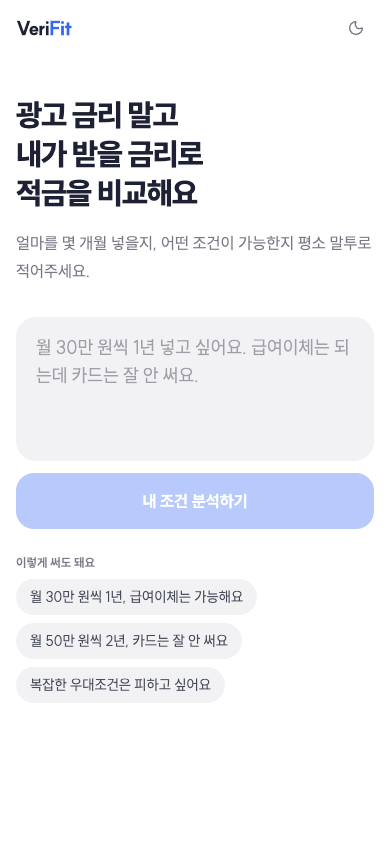
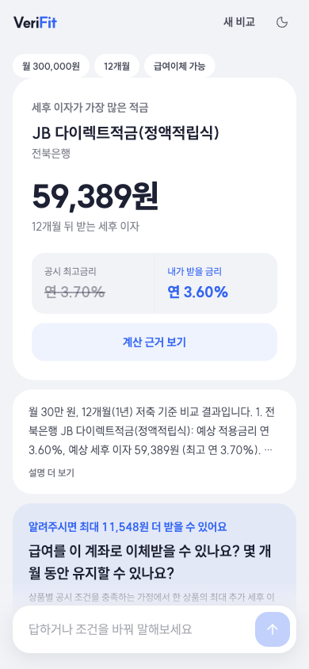
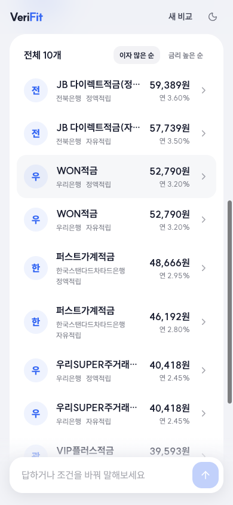
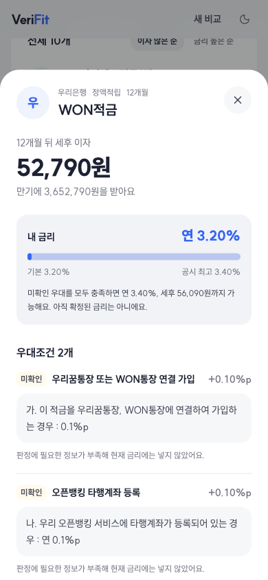
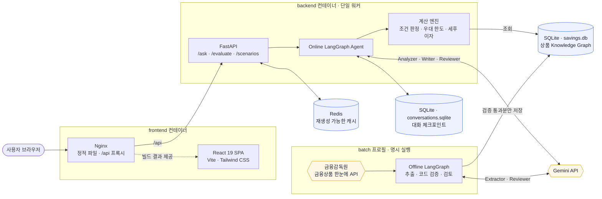
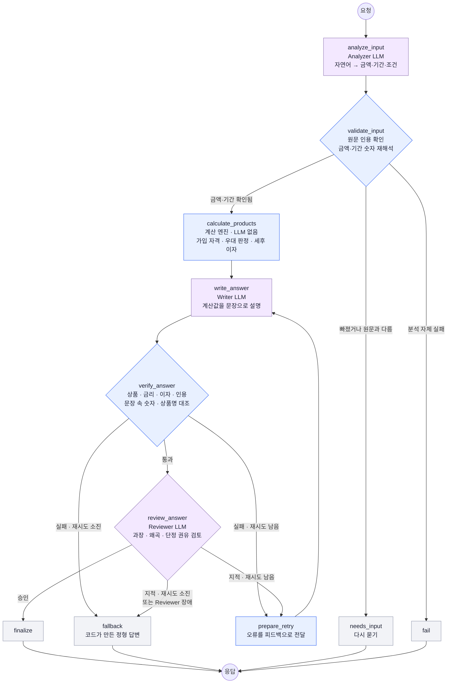
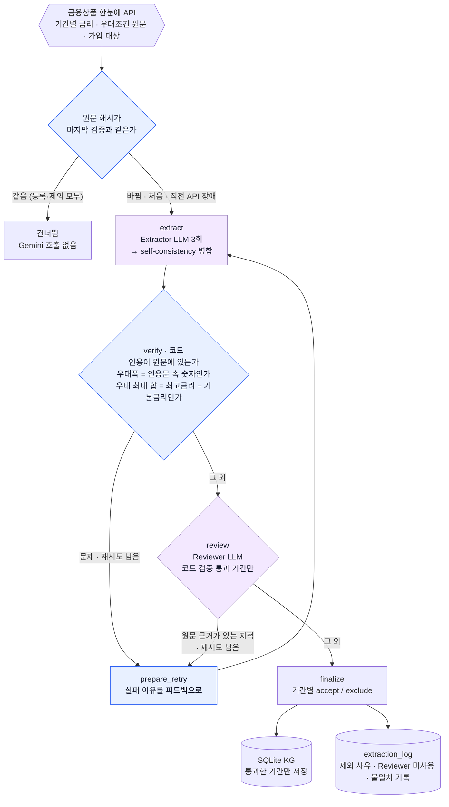
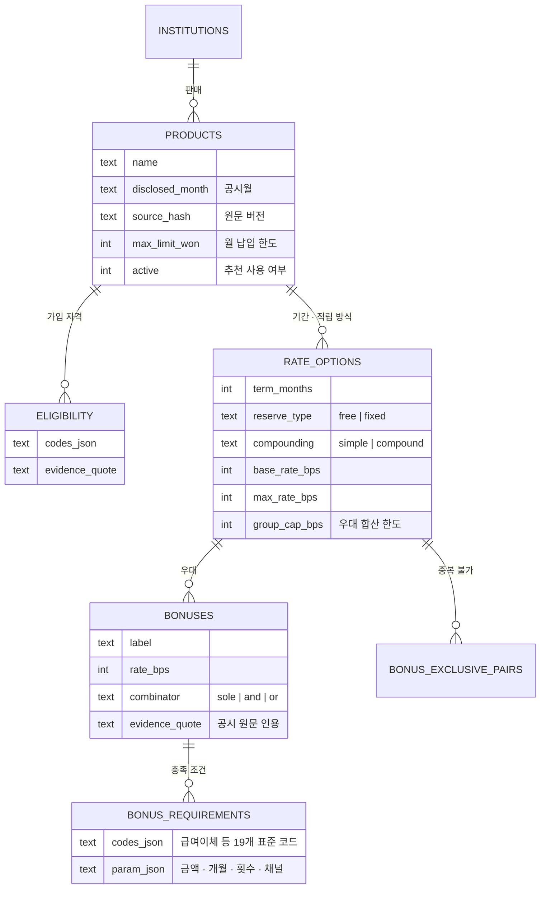

<div align="center">

# VeriFit

**광고 최고금리 말고, 내가 실제로 받을 금리로 비교하는 적금 Agent**

평소 말투로 조건을 말하면 금융감독원 공시 우대조건과 대조해<br/>
받을 수 있는 우대만 반영한 **예상 적용금리와 세후 이자**를 계산하고, 근거가 된 공시 원문까지 보여줍니다.


<br/>






</div>

<br/>

> **설계 원칙: LLM은 해석과 설명만, 판정·계산·검증은 코드가 합니다.**
> 금리와 이자는 LLM이 한 번도 계산하지 않습니다. LLM이 만든 모든 구조화 결과와 문장은 원문·계산값과 코드로 다시 대조하고, 통과하지 못하면 코드가 만든 정형 답변으로 바꿉니다.

기획 배경부터 데이터·지식 그래프·에이전트 구현까지의 과정은 [프로젝트 경험 정리](docs/project-experience.md)에, 검증 기록은 [검증 기록](docs/verification.md)에 있습니다.

## 목차

- [해결하려는 문제](#해결하려는-문제)
- [사용 흐름](#사용-흐름)
- [시스템 아키텍처](#시스템-아키텍처)
- [온라인 Agent 그래프](#온라인-agent-그래프)
- [오프라인 상품 구축 그래프](#오프라인-상품-구축-그래프)
- [가드레일 한눈에 보기](#가드레일-한눈에-보기)
- [금융상품 Knowledge Graph](#금융상품-knowledge-graph)
- [기술 스택](#기술-스택)
- [실행 방법](#실행-방법)
- [API](#api)
- [테스트](#테스트)
- [프로젝트 구조](#프로젝트-구조)
- [운영 범위와 한계](#운영-범위와-한계)

## 해결하려는 문제

적금에는 기본금리와 최고금리가 함께 표시되지만, 최고금리를 받기 위한 조건은 상품마다 다릅니다.

```text
급여이체                    +0.50%p
카드 월 30만 원 이상         +0.30%p
첫 거래 고객                 +0.20%p
마케팅 수신 동의             +0.10%p
우대금리 합산 한도           최대 0.70%p
```

단순 금리 정렬은 모든 조건을 충족했을 때의 최고금리를 보여줍니다. VeriFit은 사용자가 충족할 수 있는 조건만 계산해 다음에 답합니다.

- 내가 실제로 받을 수 있는 예상금리는 얼마인가
- 상품별 예상 세후 이자는 얼마나 차이 나는가
- 어떤 우대가 반영됐고, 어떤 우대가 빠졌고, 어떤 우대는 아직 확인이 필요한가
- 조건 하나를 바꾸면 결과가 어떻게 달라지는가
- 이 계산의 근거가 된 금융감독원 공시 문장은 무엇인가

## 사용 흐름

| 단계 | 사용자가 하는 일 | VeriFit이 하는 일 |
|---|---|---|
| 1. 조건 입력 | "월 30만 원씩 1년, 급여이체는 되는데 카드는 잘 안 써요" | Analyzer가 금액·기간·금융 습관을 `UserProfile`로 구조화하고, 코드가 원문 숫자와 다시 대조 |
| 2. 결과 확인 | 가장 이자가 많은 상품과 전체 목록 확인 | 공시 최고금리(취소선) 옆에 **내가 받을 금리**, 세후 이자, 만기 예상액 표시 |
| 3. 근거 확인 | 상품을 눌러 바텀시트 열기 | 우대별 반영 / 미충족 / 미확인 / 중복 불가 판정과 공시 원문 인용 |
| 4. 추가 질문 | "급여이체는 6개월 이상 가능해요" | 답하면 세후 이자가 가장 많이 늘 수 있는 조건부터 질문하고, 같은 대화(`thread_id`)로 재계산 |
| 5. 가정 비교 | 납입액·기간·급여이체 가정을 바꿔 보기 | LLM 없이 같은 계산 엔진으로 상품별 세후 이자 증감과 순위 변화 비교 |

<details>
<summary><b>입력이 구조화되는 모습 보기</b></summary>

```text
월 50만 원씩 2년 넣을 거야. 급여이체와 공과금 자동이체는 가능하고 카드 실적은 어려워.
```

```json
{
  "monthly_deposit_won": 500000,
  "term_months": 24,
  "facts": {
    "salary_transfer": { "satisfied": true },
    "utility_autopay": { "satisfied": true },
    "card_usage_amount": { "satisfied": false }
  }
}
```

금액과 기간은 LLM 출력만 믿지 않고, 사용자 원문에서 `30만씩`, `삼십만 원`, `1년 반`, `반년` 같은 표현을 코드로 다시 읽어 일치할 때만 계산에 씁니다.

</details>

## 시스템 아키텍처



- **SQLite가 원본 저장소**이고 Redis는 지워도 되는 캐시입니다. 임베딩·벡터 DB 기반 RAG나 별도 그래프 DB는 쓰지 않고, 계산에 연결된 공시 근거를 직접 보여줍니다.
- 구조화된 `UserProfile`을 바로 보내는 `POST /api/v1/evaluate`, `POST /api/v1/scenarios`는 LLM을 호출하지 않습니다.

## 온라인 Agent 그래프

사용자 질문 한 번(`POST /api/v1/ask`)이 지나가는 LangGraph입니다. 노드 이름은 [`backend/app/agent/workflow.py`](backend/app/agent/workflow.py)와 같습니다.



- 재시도는 대화 한 턴에 **최대 1번**이며, 코드 검증 실패와 Reviewer 지적이 같은 예산을 씁니다.
- 대화 상태는 `SqliteSaver` 체크포인트에 저장됩니다. 같은 `thread_id`로 "월 50만 원으로 바꿔줘"라고 하면 앞선 조건은 유지하고 바뀐 값만 반영합니다. 서버를 재시작해도 마지막 결과를 복원합니다.
- 체크포인트는 pickle 없이 `app.schemas`의 명시적 스키마만 역직렬화합니다.

## 오프라인 상품 구축 그래프

금융감독원 공시를 계산 가능한 지식 그래프로 바꾸는 배치입니다. 상품 하나, 적립 방식 하나마다 이 그래프가 돕니다 ([`backend/app/graph/workflow.py`](backend/app/graph/workflow.py)).



- 같은 상품이라도 **기간별로** 통과·제외가 갈립니다. 12개월은 등록되고 24개월은 빠질 수 있습니다.
- 적립 방식(자유·정액)별 결과는 합쳐서 한 번에 저장하고, 저장 도중 실패하면 변경 전체를 롤백합니다.
- 원문이 바뀌었는데 새 원문이 검증되지 않으면 이전 금리를 추천에서 비활성화합니다. 상품 하나가 예기치 못하게 실패해도 배치는 다음 상품으로 넘어갑니다.

## 가드레일 한눈에 보기

| 위치 | LLM이 만든 것 | 코드가 확인하는 것 | 통과하지 못하면 |
|---|---|---|---|
| 입력 검증 | 금액·기간·조건과 원문 인용 | 인용이 사용자 원문에 있는가, 인용 속 숫자를 코드로 다시 읽어 같은가 | 금액·기간은 **다시 묻기**, 근거 없는 조건은 버려서 미확인, 다른 세부 수치는 비움 |
| 계산 | 없음 | 조건 판정(충족·미충족·미확인), 중복 불가, 합산 한도, 공시 최고금리 상한, `Decimal` 이자 계산 | 미확인 우대는 현재 금리에 넣지 않고 가정 상한으로만 표시 |
| 답변 검증 | 답변 문장과 상품별 주장 | 주장한 상품·금리·세후 이자·인용이 계산값과 같은가, **문장 속 금리(%)·금액(원)·상품명**이 계산 결과에 있는가 | 오류를 알려주고 1회 재작성, 그래도 실패하면 정형 답변 |
| 답변 검토 | Reviewer 판정 | 승인과 지적이 동시에 오지 않는가 | 1회 재작성, Reviewer 장애 시 바로 정형 답변 |
| 상품 추출 | 우대 항목·조건 코드·금리·한도·중복 불가 | 3회 추출 간 일치, 인용이 공시 원문에 있는가, 우대폭이 인용문 숫자와 같은가, 우대 최대 합이 공시 최고금리를 정확히 설명하는가 | 흔들린 항목은 `other`로 강등, 한도·중복 불가가 갈리면 금리가 낮아지는 쪽 선택, 1회 재추출 후 해당 기간 제외 |
| 추출 검토 | Reviewer 지적 | 지적의 근거 문장이 공시 원문에 있는가 | 근거 없는 지적은 버림, Reviewer 장애는 `extraction_log`에 기록 |

> 조건을 표준 코드로 분류하지 못한 `other` 우대는 원문에 폭이 명시돼 있으면 최고금리 검사 합계에는 넣지만, **사용자 금리에는 절대 넣지 않습니다.** "재직기간에 따라 최고 1.2%p"처럼 폭을 알 수 없는 우대가 최고금리 설명에 꼭 필요한 기간은 제외됩니다.

## 금융상품 Knowledge Graph

관계형 테이블로 표현한 지식 그래프입니다 ([`backend/app/db/schema.py`](backend/app/db/schema.py)). 우대 하나하나가 계산 조건과 공시 원문 인용을 함께 가집니다.



예를 들어 아래 원문은

```text
월 50만 원 이상 급여이체를 6개월 이상 유지하면 연 1.0%p
```

이렇게 계산 가능한 구조가 됩니다.

```json
{
  "label": "급여이체 우대",
  "rate_bps": 100,
  "requirements": [{ "codes": ["salary_transfer"], "min_amount_won": 500000, "min_months": 6 }],
  "evidence": { "quote": "월 50만 원 이상 급여이체를 6개월 이상 유지하면 연 1.0%p" }
}
```

이 밖에 `product_versions`(검증 버전 보관), `extraction_log`(기간별 등록·제외 사유, Reviewer 미사용, 3회 추출 불일치), `source_checks`(마지막으로 검증한 원문 해시)가 있습니다.

## 기술 스택

| 영역 | 기술 | 역할 |
|---|---|---|
| 프론트엔드 |      | 자연어 입력, 결과 목록, 근거 바텀시트, 가정 비교, 대화 복원, 라이트·다크 테마 |
| 백엔드 |     | REST API, 입력·LLM 출력·API 계약 스키마 검증, 외부 API 호출 |
| 에이전트·LLM |   | 온라인·오프라인 그래프, 조건 분기, 재시도, fallback / Extractor·Analyzer·Writer·Reviewer |
| 데이터 |   | 상품 KG·공시 버전·추출 기록·대화 체크포인트 / 다계층 캐시 |
| 인프라 |   | 웹·API·Redis·배치 서비스, 멀티스테이지 빌드, 상태 확인 / 정적 파일과 API 프록시 |
| 테스트·품질 |     | 계산·가드레일·그래프 라우팅·저장·캐시 회귀 테스트, 화면 흐름 테스트, 정적 검사 |
| 데이터 출처 |  | 적금 상품, 가입 대상, 우대조건 원문, 기간별 금리 |

## 실행 방법

### Docker로 실행 (권장)

Docker Desktop만 있으면 됩니다. 로컬 Python·Node 설치는 필요 없습니다.

```bash
# 처음 한 번만 복사하고 FINLIFE_API_KEY, GEMINI_API_KEY를 입력합니다. 기존 .env는 덮어쓰지 마세요.
cp -n .env.example .env

docker compose up --build -d
```

| 주소 | 내용 |
|---|---|
| http://localhost:3000 | 웹 화면 |
| http://localhost:8000/docs | API 문서 |

새 설치에는 상품이 없으므로 배치를 한 번 실행합니다. **Gemini 호출 비용이 발생합니다.**

```bash
docker compose --profile batch run --rm batch

# 하루 간격 갱신 (별도 터미널, 중지 Ctrl+C). 원문이 그대로인 상품은 등록·제외 모두 건너뜁니다.
docker compose --profile batch run --rm batch \
  python scripts/run_savings_batch.py --db-path /app/data/savings.db --interval-seconds 86400
```

<details>
<summary><b>Docker 운영 메모</b></summary>

- 상태 확인 `docker compose ps`, 로그 `docker compose logs -f backend frontend`, 중지 `docker compose down`
- 상품 DB와 대화 기록은 루트 `data/`를 컨테이너 `/app/data`에 연결해 유지합니다. 컨테이너를 지워도 남습니다.
- 포트가 겹치면 `.env`에 `VERIFIT_WEB_PORT=3001`, `VERIFIT_API_PORT=8001`, 데이터 위치는 `VERIFIT_DATA_DIR=/절대경로/data`
- Linux에서 데이터 폴더 쓰기 권한 오류가 나면 컨테이너 사용자 UID `10001`에 쓰기 권한을 줍니다.
- API 키 변경은 `docker compose up -d --force-recreate`, 코드 변경은 `docker compose up --build -d`
- SQLite 체크포인트와 요청 잠금 설계에 맞춰 API는 단일 워커로 실행하고, 호스트 포트는 로컬에서만 열립니다.

</details>

### 직접 실행

```bash
# 백엔드
cd backend
python3 -m venv .venv && source .venv/bin/activate
pip install -e '.[dev]'
.venv/bin/python scripts/run_savings_batch.py --limit 5 --db-path ../data/savings.db   # 소량 구축
.venv/bin/python run.py                                                                 # http://127.0.0.1:8000

# 프론트엔드
cd frontend
npm install
npm run dev                                                                             # http://127.0.0.1:5173
```

<details>
<summary><b>환경 변수</b></summary>

프로젝트 루트 `.env`:

```dotenv
FINLIFE_API_KEY=발급받은_키
GEMINI_API_KEY=발급받은_키

EXTRACTOR_MODEL=gemini-3.7-flash
REVIEWER_MODEL=gemini-3.7-flash
ONLINE_AGENT_MODEL=gemini-3.7-flash
# 선택: 기본값은 data/conversations.sqlite
CHECKPOINT_PATH=/절대경로/savings_agent/data/conversations.sqlite
```

다른 API 주소를 쓰려면 `frontend/.env`에 `VITE_API_BASE_URL=http://127.0.0.1:8000`을 설정합니다.

</details>

<details>
<summary><b>캐싱 계층</b></summary>

Compose는 Redis를 함께 실행하고, 직접 실행에서 `REDIS_URL`이 없으면 메모리 캐시를 씁니다.

| 대상 | 키에 포함되는 정보 | 기본 유효기간 |
|---|---|---|
| 상품 KG | DB 고유 ID + 상품 데이터 revision | 1시간 |
| 금리·이자·추가 질문 계산 | 전체 상품 스냅샷 + 정규화한 사용자 프로필 | 30분 |
| 시나리오 비교 | 상품 스냅샷 + 기준 프로필 + 변경 가정 | 30분 |
| Analyzer·Writer·Reviewer | 모델·계정 해시 + 전체 프롬프트·스키마·입력·피드백 | 10분 |
| 최종 Agent 결과 | 전체 사용자 대화 + 상품 스냅샷 + 모델·계정 해시 | 10분 |
| 대화 결과 복원 | 대화 ID + SQLite 체크포인트 ID | 10분 |
| 배치 추출·검토 | 모델·계정 해시 + 원문·금리·프롬프트·피드백 | 10분 |

- 모든 키에 앱 소스 버전 해시가 들어가서 계산 코드·프롬프트·스키마가 바뀌면 이전 캐시를 쓰지 않습니다.
- 상품 테이블이 바뀌면 SQLite 트리거가 같은 트랜잭션에서 revision을 올립니다.
- 오류, 파싱 실패, 거부된 검토, fallback 응답은 성공 결과처럼 캐싱하지 않습니다. 캐시에서 가져온 LLM 출력도 그래프의 입력·숫자·근거 검증을 그대로 거칩니다.
- Redis는 호스트 포트를 열지 않고 영속화를 끕니다. 키에는 원문이나 API 키를 넣지 않습니다. Redis가 죽으면 짧은 타임아웃 뒤 메모리 캐시로 전환합니다.
- `CACHE_ENABLED=false`로 전체 캐시를 끄거나 대상 TTL을 `0`으로 해당 계층만 끌 수 있습니다.

```bash
curl http://localhost:3000/api/v1/cache/status          # 계층별 hit/miss/store (키·사용자 내용 없음)
docker compose exec redis redis-cli FLUSHDB             # 캐시만 비우기 (SQLite 원본은 유지)
```

</details>

## API

| 메서드 | 경로 | 설명 | LLM |
|---|---|---|:---:|
| `POST` | `/api/v1/ask` | 자연어 조건으로 비교. 후속 요청은 받은 `thread_id`를 함께 전달 | ✅ |
| `GET` | `/api/v1/ask/{thread_id}` | 체크포인트의 마지막 응답 복원. 없으면 404 | |
| `POST` | `/api/v1/evaluate` | 구조화된 `UserProfile`을 바로 계산 | |
| `POST` | `/api/v1/scenarios` | 기준 프로필과 최대 5개 가정의 세후 이자·순위 비교 | |
| `GET` | `/health` | 서버 상태 | |
| `GET` | `/api/v1/cache/status` | 캐시 계층별 통계 | |

<details>
<summary><b>요청·응답 예시</b></summary>

```json
// POST /api/v1/ask
{ "message": "매달 30만 원씩 1년 넣고 싶고 급여이체는 가능해." }

// 필수 정보가 부족하면 status: "needs_input"과 questions를 돌려줍니다. 후속 요청:
{ "thread_id": "이전 응답의 값", "message": "매달 30만 원이야." }
```

```json
// POST /api/v1/evaluate
{
  "monthly_deposit_won": 300000,
  "term_months": 12,
  "facts": {
    "salary_transfer": { "satisfied": true, "months": 12 },
    "card_usage_amount": { "satisfied": false }
  }
}
```

`/ask` 응답에는 계산 결과 외에 `used_fallback`(정형 답변 전환 여부), `retry_count`, `verification_errors`, `input_warnings`(버리거나 비운 입력과 이유)가 들어 있어 어떤 가드레일이 작동했는지 확인할 수 있습니다.

</details>

## 테스트

```bash
# 백엔드: 계산·가드레일·그래프 라우팅·저장·캐시 (외부 API 호출 없음)
cd backend
.venv/bin/python -m pytest -q
.venv/bin/python scripts/run_online_regression.py          # 정답 9건의 계약 검증

# 실제 모델 검증: Gemini 호출 비용 발생
.venv/bin/python scripts/run_online_regression.py --live   # Analyzer 회귀 평가
.venv/bin/python scripts/validate_live_workflow.py         # 상품 DB 복사본으로 실제 Agent 2턴

# 프론트엔드
cd frontend
npm test && npm run build && npm run lint
```

| 범위 | 자동 테스트가 확인하는 것 |
|---|---|
| 계산 | 금액 임계값 전후, 나이 상·하한, AND/OR 삼상 논리, 우대 한도·연결된 중복 불가의 최적 조합, 단리·복리 |
| 입력 가드레일 | 한국어 금액·기간 해석, 원문과 다른 숫자 → 다시 묻기, 근거 없는 조건 → 미확인 |
| 답변 가드레일 | 계산 결과에 없는 금리·금액, 반올림한 금액, 주장 없이 언급한 상품, 1회 재작성, Reviewer 장애 시 정형 답변 |
| 추출 가드레일 | 인용 위조, 우대폭-원문 숫자 불일치, 최고금리 미달·초과, 3회 추출 불일치, 근거 없는 Reviewer 지적 |
| 저장·갱신 | 저장 롤백, 최신 공시 조회, 원문 변경 시 재검증, 제외 상품 재추출 방지, API 장애 상품 재시도, 상품 하나 실패 시 계속 진행 |
| 대화 | SQLite 체크포인트 재시작 복원, 같은 대화의 후속 질문, 캐시 적중 시 별도 대화 기록 |
| 화면 | 입력 → 결과 → 추가 질문 → 후속 대화, 새로고침 복원, 근거 바텀시트, 가정 비교 |

`--live` 없이 돌리는 회귀 스크립트는 정답 데이터의 계약 검증이지 모델 성능 평가가 아닙니다. 실제 호출 보고서에는 모델명과 프롬프트 소스 해시가 남습니다.

## 프로젝트 구조

```text
savings_agent/
├─ compose.yaml            # 웹·API·Redis·배치 서비스
├─ backend/
│  ├─ app/
│  │  ├─ agent/            # 온라인 LangGraph (질문 1회 처리)
│  │  ├─ graph/            # 오프라인 LangGraph (상품 1개 구조화)
│  │  ├─ services/         # 추출·검증·도달가능성·매칭·이자 계산·한국어 숫자 해석
│  │  ├─ db/               # SQLite 스키마·저장·조회
│  │  ├─ schemas/          # Graph·Agent·사용자·캐시 스키마
│  │  ├─ api/routes/       # ask, evaluate, scenarios, health
│  │  ├─ core/             # 설정·Redis/메모리 캐시
│  │  └─ integrations/     # 금융상품 한눈에 연동
│  ├─ scripts/             # 상품 구축 배치, 회귀·실모델 검증
│  └─ tests/
├─ frontend/
│  ├─ nginx.conf           # SPA·API 프록시
│  └─ src/
│     ├─ components/       # 상품 목록·근거 바텀시트·가정 비교·공용 UI
│     ├─ design-system/    # 색상·타이포그래피 토큰, 테마
│     ├─ lib/              # API 클라이언트, 숫자 포맷
│     └─ types/
├─ data/                   # savings.db(상품 KG), conversations.sqlite(대화)
└─ docs/                   # 프로젝트 경험, 검증 기록, 화면 캡처
```

## 운영 범위와 한계

- **로컬·단일 프로세스 서비스**입니다. 사용자 인증이 없어서 공개 배포에는 사용자별 접근 제어와 다중 워커용 체크포인트·잠금 설계가 따로 필요합니다. 대화 ID를 다른 사람과 공유하지 마세요.
- 이자 계산은 **일반과세 15.4%, 매월 같은 금액을 만기까지 납입**하는 기준입니다. 자유적립식도 공시 금리 옵션은 따로 쓰지만 납입 방식은 정액과 같게 가정하고, 비과세·세금우대 특례는 반영하지 않습니다.
- `other` 가입 자격과 원문에 없는 세부 기준은 자동으로 확정하지 않습니다. 실제 적용금리와 가입 가능 여부는 금융회사 확인이 필요하고, 사용자가 말한 실적은 해당 금융회사 기준이어야 합니다.
- 미확인 우대를 충족했을 때의 금리는 가정 상한이지 수익 약속이 아닙니다.
- 반복 추출·코드 검증·Reviewer는 정확도를 높이는 장치이지 정답을 보증하지 않습니다. 같은 모델을 3회 돌려 비교하는 것은 독립 모델 간 합의가 아니어서, 매번 똑같이 틀리는 오류는 최고금리 검사 같은 숫자 검증에 의존합니다.
- Reviewer 호출이 실패해도 코드 검증을 통과한 기간은 저장하며, 그 사실을 `extraction_log.reviewer_unavailable`에 남깁니다.
- 갱신은 배치 주기를 따릅니다. API에서 사라진 상품의 판매 종료는 자동으로 확정하지 않습니다.
